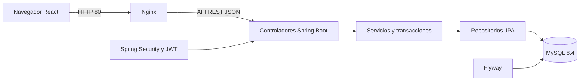
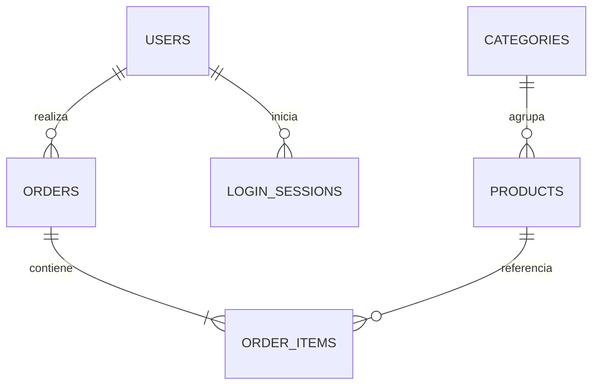

# Integración de Veterinaria San Marcos

Versión 1.1. Revisión del 22 de noviembre de 2026.

La aplicación integra una SPA React con una API Spring Boot y una base de datos relacional. En Amazon Linux, Docker Compose inicia MySQL 8.4, backend y Nginx con el frontend. Las llamadas del navegador usan `/api/v1` en el mismo origen.

## Arquitectura y responsabilidades



Los controladores validan DTO y traducen operaciones HTTP. Los servicios encapsulan las reglas de negocio. Los repositorios consultan y bloquean filas cuando cambia el inventario. Los DTO evitan exponer entidades JPA o hashes de contraseña. `GlobalExceptionHandler` produce errores JSON consistentes.

Esta es una aplicación Spring Boot por capas. La existencia de varios servicios Java dentro del mismo proceso no la convierte en microservicios independientes.

## Modelo de datos



| Tabla | Propósito y relación |
|---|---|
| users | Identidad, correo único, hash BCrypt y rol |
| categories | Categoría única de los productos |
| products | Precio CLP, stock, oferta, descripción, emoji, foto y eliminación lógica |
| orders | Usuario propietario, datos de entrega, total y estado |
| order_items | Producto, cantidad, nombre y precio históricos de cada línea |
| login_sessions | Usuario, hash del refresh, vencimiento y revocación |

El modelo propuesto en el Anexo 1 utiliza USUARIO, BOLETA, DETALLE_BOLETA, PRODUCTO y CATEGORIA. En esta implementación `orders` y `order_items` representan el pedido y sus líneas. No son documentos tributarios emitidos por el SII.

Flyway crea y actualiza el esquema: V1 define las tablas, V2 carga categorías y productos, V3 conserva la migración histórica de imágenes y V4 añade sesiones y amplía la longitud de las URL de imagen. No se modifican V1, V2 ni la V3 histórica. Hibernate usa `ddl-auto=validate`.

## Contrato REST

- Base local: `http://localhost:8080/api/v1`.
- Base en AWS: `http://IP_PUBLICA_EC2/api/v1`.
- Swagger: `/swagger-ui.html`.
- OpenAPI: `/v3/api-docs`.
- Documentación de los 19 endpoints: [Documentacion_API.xlsx](Documentacion_API.xlsx).
- Listado revisable en texto: [endpoints.json](endpoints.json).

Las rutas antiguas `/api` se conservan como compatibilidad. Swagger publica `/api/v1`. Las operaciones de lectura usan GET, las creaciones POST, el reemplazo de productos PUT, la eliminación lógica DELETE y los cambios parciales de estado o rol PATCH.

Los errores tienen la forma `{"error":"mensaje","fields":{"campo":"detalle"}}`. `fields` se usa cuando corresponde a validación de campos. Se responde 400 para datos inválidos, 401 para falta de sesión, 403 para un rol sin permiso, 404 para recursos inexistentes y 409 para conflictos de stock, duplicados o estados finales.

## Flujo de autenticación y sesión

1. React envía correo y contraseña a `/auth/login`. El registro público asigna siempre CLIENTE.
2. El backend compara el hash BCrypt y crea una sesión. Devuelve accessToken, refreshToken, tokenType y usuario.
3. El accessToken dura 15 minutos. El frontend lo envía en `Authorization: Bearer`.
4. El filtro JWT valida firma, expiración y tipo, comprueba que la sesión siga vigente y carga el rol actual desde la base de datos.
5. Al recargar, React valida `/auth/me` antes de mostrar rutas protegidas.
6. La renovación valida el refresh, bloquea la fila de sesión, compara su hash SHA-256 y guarda un hash nuevo. Un refresh utilizado deja de funcionar.
7. Logout revoca la sesión en la base y borra la sesión del navegador. Los tokens de esa sesión ya no permiten acceder a la API.

Las solicitudes de renovación simultáneas comparten una promesa. Cuando está disponible, Web Locks coordina la renovación entre pestañas. Si la red falla, se conservan las credenciales para reintentar. Una respuesta pendiente no debe restaurar una sesión cerrada ni reemplazar un nuevo inicio de sesión.

Los tokens se guardan en localStorage para mantener la sesión entre recargas. Ese almacenamiento es accesible a JavaScript y requiere controlar XSS y usar HTTPS en un despliegue con datos reales. No se presenta como una solución que elimine todos los riesgos de sesión.

## Flujo de compra y stock

React envía datos del comprador y una lista de productId y quantity. El servidor agrupa productos repetidos, bloquea las filas en orden de identificador, valida existencias y obtiene los precios de la base. Guarda el pedido y descuenta el inventario en una transacción. Si falta stock, devuelve 409.

El pedido conserva nombre y precio históricos. Cancelar bloquea el pedido y los productos, repone existencias y lo deja en un estado final. Dos cancelaciones simultáneas no reponen dos veces la misma cantidad. Un pedido entregado tampoco puede retroceder de estado.

El medio de pago seleccionado se registra como dato. No se llama a una pasarela de cobro.

## Autorización en dos capas

`ProtectedRoute` restringe páginas según el usuario validado. El vendedor recibe su panel de consulta y no ve opciones de carrito, administración ni usuarios. El cliente accede a la tienda y a su historial. El administrador mantiene productos, estados y roles.

Spring Security repite la comprobación sobre cada endpoint. Ocultar un botón no sustituye esta validación. Las pruebas envían solicitudes directas como vendedor y cliente para comprobar respuestas 403 aunque se omita la interfaz.

## Evidencia y reproducción

```bash
# Backend: desde backend-veterinaria/backend
./mvnw test

# Frontend: desde VETERINARIA_SAN_MARCOS
npm ci
npm test
npm run build
npm run test:e2e
```

En Windows se utiliza `mvnw.cmd`. Playwright requiere una API encendida con las cuentas de demostración del entorno local. En CI se prueba además el backend con MySQL y el navegador contra Nginx y MySQL.

La verificación local registró 18 pruebas backend, 29 pruebas de servicios/componentes y 6 escenarios de navegador. Las capturas reales están en [MANUAL_USUARIO.md](MANUAL_USUARIO.md). La configuración reproducible está en `.github/workflows/ci.yml` y `.github/workflows/validacion.yml`.

La configuración, las verificaciones de arranque y los comandos para la instancia existente se describen en [DEPLOY-AMAZON-LINUX.md](../DEPLOY-AMAZON-LINUX.md).
