# Manual de usuario de Veterinaria San Marcos

Versión 1.1. Revisión del 22 de noviembre de 2026.

Este manual explica el uso de la tienda para clientes, vendedores y administradores. Las capturas corresponden a una ejecución local real con datos de demostración. En AWS se utilizan las cuentas creadas para ese despliegue.

## Requisitos y puesta en marcha

Para usar el sistema necesitas un navegador actualizado y conexión a internet. Abre la dirección pública entregada al terminar el despliegue. La instalación del servidor se describe en [DEPLOY-AMAZON-LINUX.md](../DEPLOY-AMAZON-LINUX.md).

El despliegue desactiva las cuentas demo. La contraseña inicial del administrador queda en `backend/.env` del servidor. Registra las cuentas de cliente desde Crear cuenta y asigna roles desde la cuenta ADMIN.

## Perfiles

| Perfil | Funciones |
|---|---|
| CLIENTE | Catálogo, carrito, registro de compra e historial propio |
| VENDEDOR | Consulta de lista y detalle de productos y pedidos |
| ADMIN | Productos, estados de pedidos, usuarios y roles |

Para terminar, pulsa Salir. Si la red no está disponible, la sesión del navegador se cierra y puede requerirse revocar la sesión del servidor al recuperar conectividad. Una contraseña o sesión rechazada requiere volver a ingresar.

## Uso paso a paso

### Figura 1 Inicio de la tienda

Nota. Desde el inicio puedes abrir la tienda, consultar ofertas o ingresar a tu cuenta.

### Figura 2 Inicio de sesión

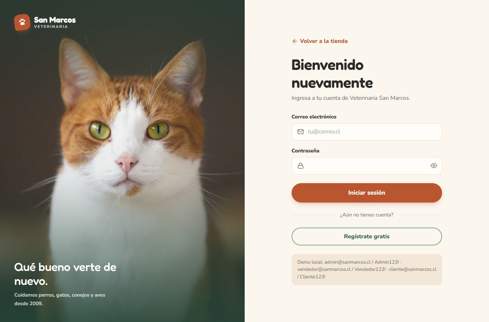

Nota. Escribe correo y contraseña y pulsa Iniciar sesión. En Crear cuenta completa nombre, correo y contraseña; el registro crea un cliente.

### Figura 3 Catálogo de productos

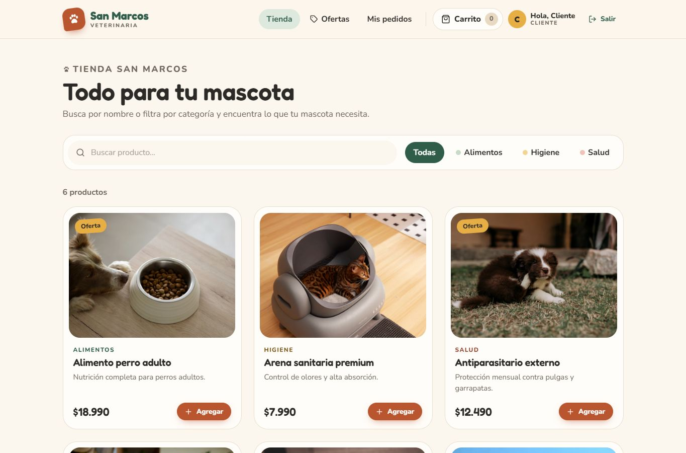

Nota. Consulta categorías y ofertas. Pulsa Agregar para incluir un producto con stock en el carrito.

### Figura 4 Revisión del carrito

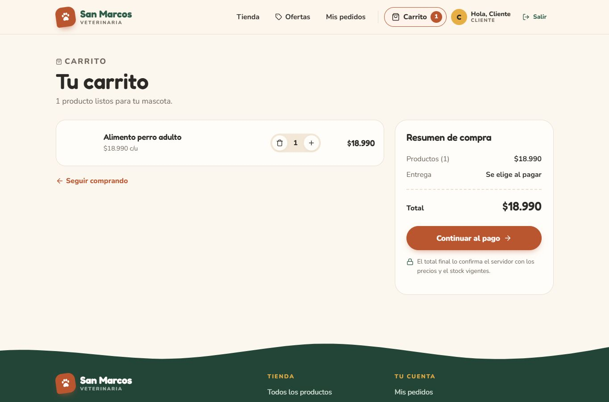

Nota. Revisa productos, cantidades y total antes de abrir Finalizar compra. Puedes ajustar las cantidades o retirar productos.

### Figura 5 Datos de compra y entrega

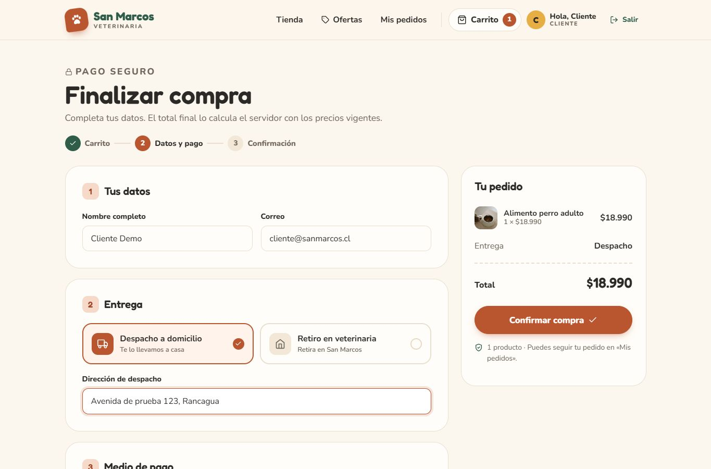

Nota. Completa nombre, correo y dirección. Selecciona entrega y medio de pago. Pulsa Confirmar compra una sola vez y espera el resultado.

### Figura 6 Pedido confirmado

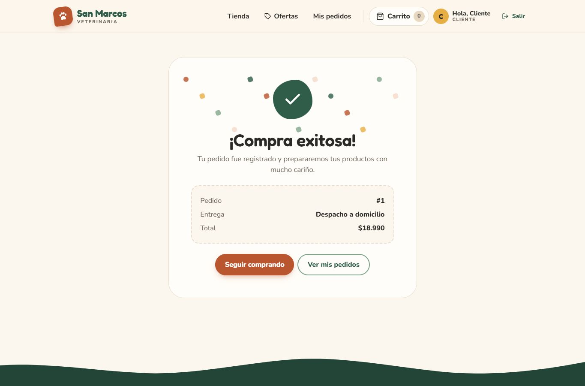

Nota. La confirmación muestra identificador y total del pedido registrado. El sistema no realiza un cobro bancario ni emite una boleta tributaria.

### Figura 7 Historial del cliente

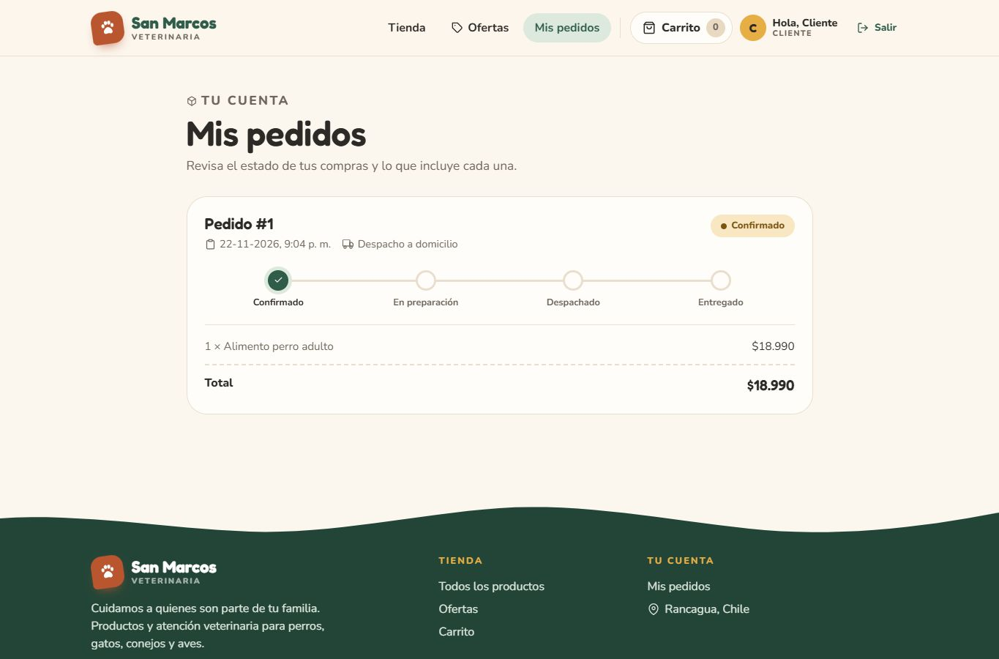

Nota. Abre Mis pedidos para revisar tus compras y su estado. El historial se conserva al recargar la página mientras la sesión siga vigente.

### Figura 8 Acceso restringido

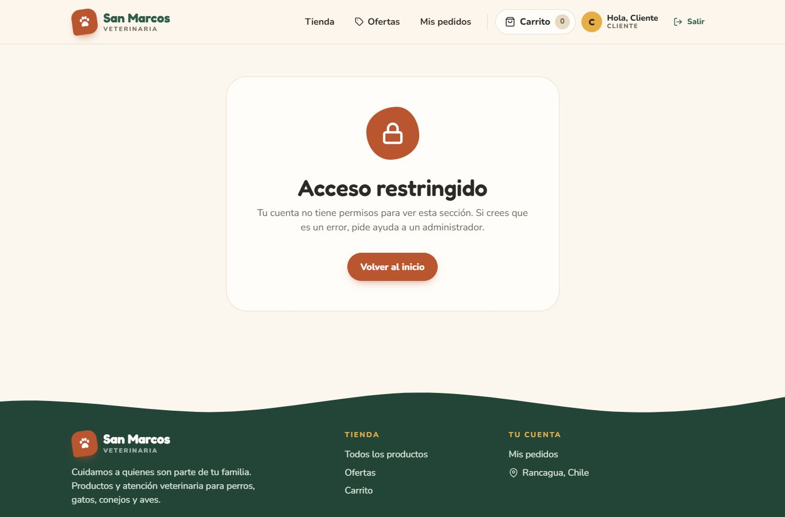

Nota. Si tu rol no permite una función, aparece esta pantalla. Usa los accesos disponibles para tu cuenta.

### Figura 9 Consulta de productos para vendedor

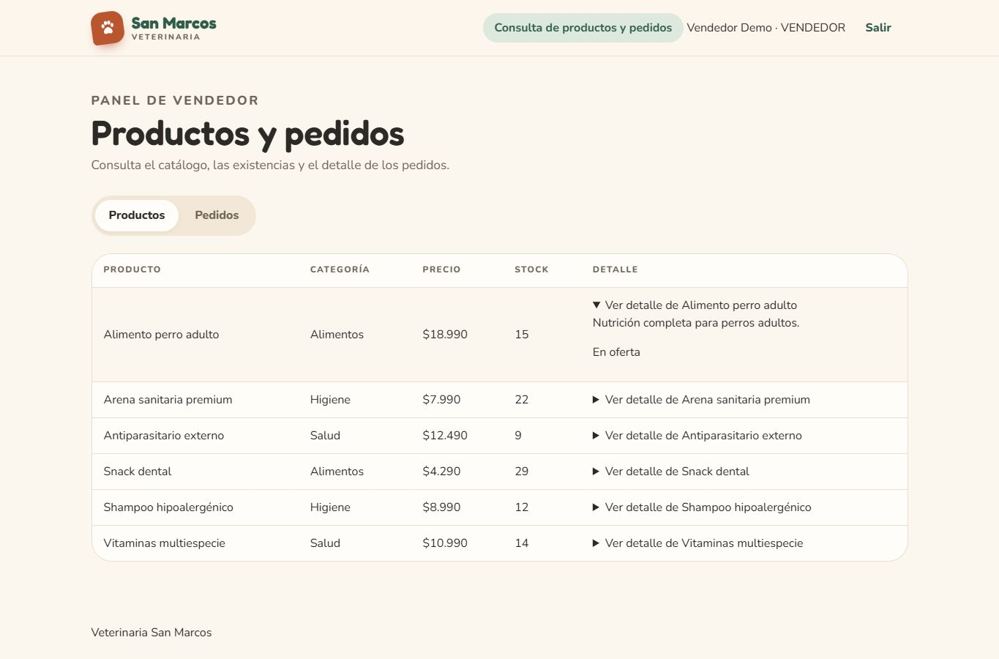

Nota. El vendedor consulta productos, precio, stock y descripción desde Ver detalle. La vista no incluye acciones de edición ni compra.

### Figura 10 Consulta de pedidos para vendedor

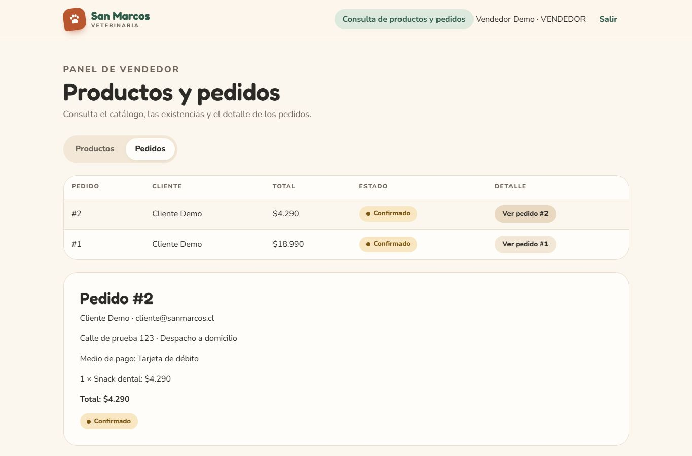

Nota. Abre Pedidos y pulsa Ver pedido para consultar cliente, entrega, líneas, total y estado. El vendedor no modifica el pedido.

### Figura 11 Administración de productos

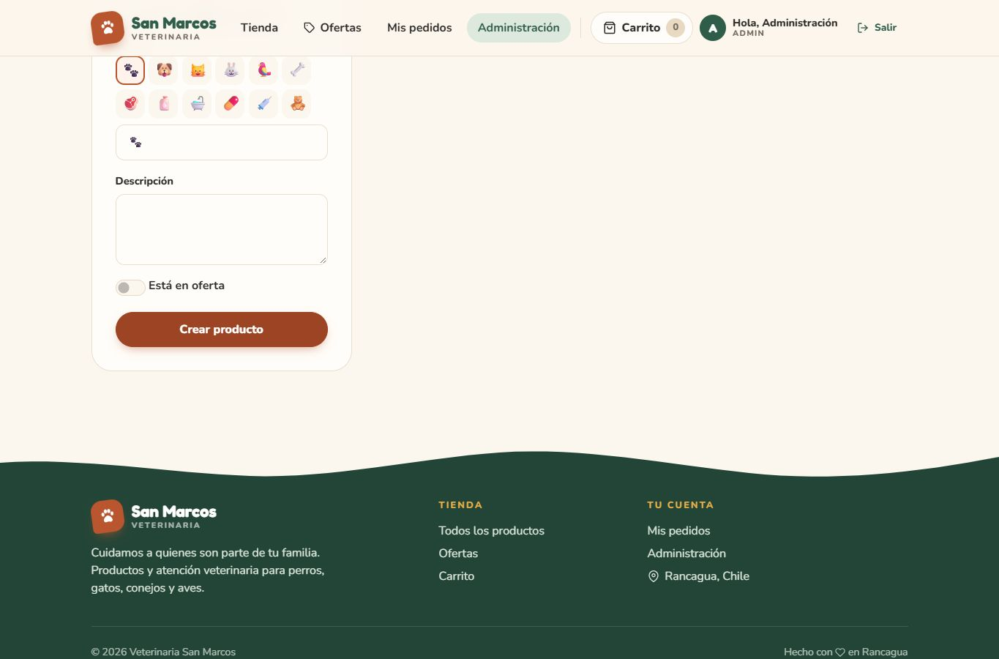

Nota. En Productos completa nombre, categoría, precio, stock y descripción, y elige una foto si corresponde. Pulsa Crear producto. Para editar usa Editar en la fila y luego Actualizar. Para eliminar usa el botón de papelera y confirma.

### Figura 12 Administración de pedidos

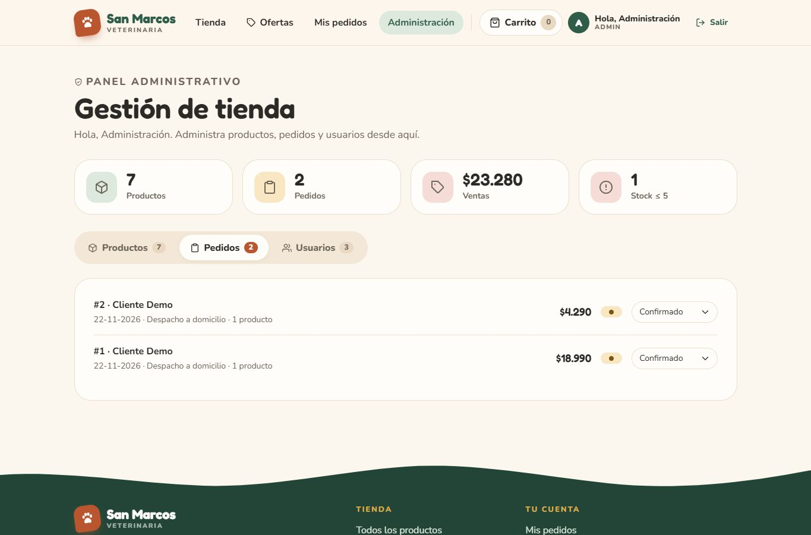

Nota. En Pedidos selecciona el estado correspondiente. Cancelar devuelve stock. Los pedidos cancelados y entregados son finales.

### Figura 13 Administración de roles

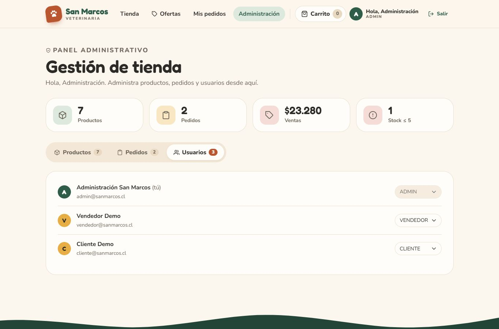

Nota. En Usuarios elige CLIENTE, VENDEDOR o ADMIN para otra cuenta. El sistema no permite cambiar tu propio rol.

### Figura 14 Consulta desde un teléfono

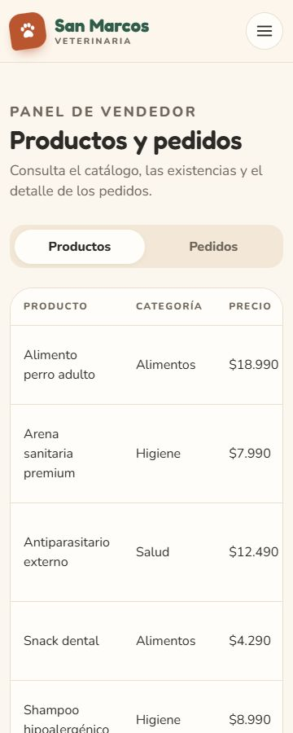

Nota. En pantallas pequeñas abre el menú de navegación. Las tablas pueden desplazarse dentro de su contenedor para consultar todas las columnas.

## Problemas frecuentes

| Mensaje o situación | Acción |
|---|---|
| Correo o contraseña incorrectos | Revisa los datos e intenta de nuevo |
| Sesión expirada | Vuelve a iniciar sesión |
| Stock insuficiente | Revisa las cantidades actualizadas del carrito |
| No se pudo conectar con el servidor | Espera un momento y reintenta; si continúa, informa al administrador |
| No tienes permisos | Utiliza una cuenta con el rol correspondiente |

El catálogo y los pedidos provienen de la API. Si el servidor no está disponible, la aplicación muestra un mensaje de error y no sustituye esas operaciones por datos simulados.
